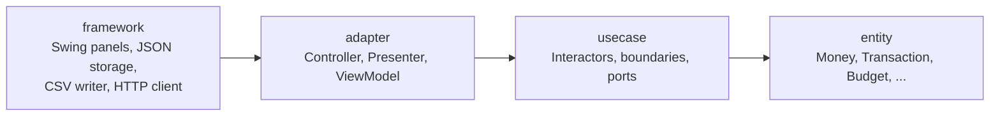
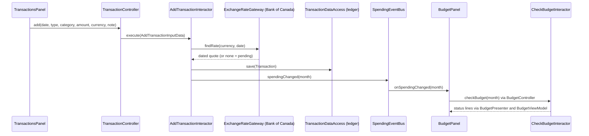
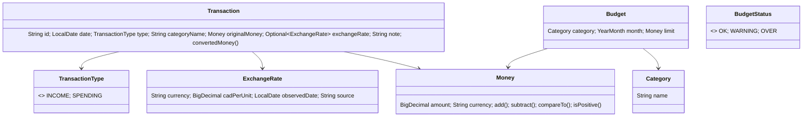

# Budgeting App (CSC207 project)

A Swing desktop app for **international students who spend in more than one currency**.
Record income and spending in CAD, USD or CNY, see each amount converted to CAD with a
dated reference rate from the Bank of Canada, set monthly budgets per category, and get a
warning when spending gets close to (or goes over) a limit.

Java 17+ / Maven / Swing. Built with Clean Architecture.

## Contents

1. [Run and test](#run-and-test)
2. [Features](#features)
3. [User stories](#user-stories)
4. [Use cases and owners](#use-cases-and-owners)
5. [Architecture](#architecture)
6. [Entities](#entities)
7. [Design patterns](#design-patterns)
8. [External API](#external-api)
9. [Accessibility](#accessibility)
10. [Data storage](#data-storage)
11. [Testing](#testing)
12. [Known limitations](#known-limitations)
13. [Team and contributions](#team-and-contributions)

## Run and test

1. Open `pom.xml` as a Maven project in IntelliJ (JDK 17 or newer).
2. Run `app.Launcher`. A window with four tabs opens: Transactions, Budget, Summary, Categories.
3. Run the tests with `mvn test` (or Maven's `test` lifecycle goal in IntelliJ).

To check the live exchange-rate call separately from the unit tests, run `app.ExchangeRateSmokeCheck`.

### Quick demo

1. **Transactions:** add a spending of 2650 CAD in Rent, then 50 USD in Transport. The list shows the
   original amount, the CAD reference amount, the rate and the quote date.
2. **Budget:** pick Rent, set a limit of 3000, click **Set budget**. A line such as
   `[WARNING] Rent: 2650.00 of 3000.00 CAD used (88.3%), 350.00 left. Close to the limit.` appears.
3. Go back to **Transactions** and add another 100 CAD in Rent. The Budget tab updates by itself
   (**Refresh status** also works).
4. **Summary:** choose a date in the month to see income, spending, net, category totals and the
   transactions. **Export CSV…** saves the month to a file.
5. Close and reopen the app: your data is still there.

## Features

- **Transactions:** add positive CAD, USD or CNY income or spending; each row shows the original
  amount, the CAD reference estimate, the quote date, the note and the pending-conversion status.
- **Exchange rates:** Bank of Canada Valet historical quotes, using the quote on or before the
  transaction date. If no quote can be found, the transaction is saved as **PENDING CONVERSION** and
  is excluded from totals instead of being counted as zero.
- **Budget:** a monthly limit per category. The status of each category is `OK`, `WARNING` (80% up to
  and including 100% of the limit) or `OVER` (above 100%). The selected month refreshes automatically
  after a transaction is saved; **Refresh status** also updates it manually. Income and pending
  conversions are excluded from spending totals.
- **Summary:** choose any date in a month to see income, spending, net, category totals and the
  underlying transactions. Pending conversions stay visible in the list and are flagged as excluded
  from the totals.
- **Categories:** add names, rename selected categories and delete unused categories. Renaming
  updates existing transactions and budgets together. Category names are unique without regard to case.
- **Local storage:** transactions, budgets and categories are saved to
  `~/.csc207-budget/ledger.json`. Reopening the app restores them. If the file cannot be read, the app
  shows an error before opening the ledger.
- **CSV export:** in Summary, choose a month and click **Export CSV…**. The UTF-8 file contains that
  month's transaction rows, original and CAD amounts, and the quote date. Rows waiting for conversion
  have a blank CAD amount and a `PENDING` status.

Not implemented yet: editing or deleting transactions, retrying a pending conversion, changing the
base currency (it is CAD), importing CSV.

## User stories

- **Transactions (Siyuan Kevin Li):** As an international student who spends in several currencies,
  I want each purchase saved with its original amount and a dated CAD reference amount so that I
  understand what I really spent and keep the original record.
- **Budget (Chris Guo):** As a student on a tight budget, I want to set a monthly budget for each
  spending category and be warned when my spending gets close to the limit so that I can adjust my
  spending before I go over.
- **Budget, accessibility (Chris Guo):** As a user who is color-blind or uses a screen reader, I want
  budget status shown as text and a symbol, not only as a color, so that I never miss an overspending
  warning.
- **Summary and export (Su Pu):** As a student, I want to see my income, spending and category totals
  for a month, and export them to CSV, so that I can see where my money went and open the data in Excel.
- **Categories and storage (Su Pu):** As a student, I want to manage my own categories and keep my data
  when I close the app so that the budget matches how I spend and I don't have to re-enter anything.

## Use cases and owners

| Use case | Package | Owner |
| --- | --- | --- |
| AddTransaction (with exchange-rate lookup) | `usecase.add_transaction` | Siyuan Kevin Li |
| SetBudget | `usecase.set_budget` | Chris Guo |
| CheckBudgetStatus (alerts) | `usecase.check_budget` | Chris Guo |
| GetMonthlySummary | `usecase.monthly_summary` | Su Pu |
| ManageCategories (add, rename, delete) | `usecase.manage_categories` | Su Pu |
| ExportCsv | `usecase.export_csv` | Su Pu |

Each use case has an Input Boundary, Interactor, Output Boundary and (where needed) Input and Output
Data, plus a Controller, Presenter and ViewModel in `adapter` and a Swing panel in `framework`.

## Architecture

We follow Clean Architecture. Source code depends only inward:

- `app/ApplicationBuilder` is the one place that creates every concrete class and connects them.
- Use cases depend on **port interfaces** in `usecase.port` (`TransactionDataAccess`,
  `BudgetDataAccess`, `CategoryDataAccess`, `ExchangeRateGateway`, `SpendingDataAccess`,
  `SpendingChangeNotifier`, ...). Storage, the HTTP client and the CSV writer implement them in `framework`.
- `ArchitectureRulesTest` fails the build if `entity`, `usecase` or `adapter` import Swing/AWT,
  `java.io`, `java.sql`, `java.net` or an outer layer.

See [the architecture guide](docs/ARCHITECTURE.md) for the package table and how to add a feature.

### Sequence: adding a transaction updates the Budget tab

## Entities

Amounts and rates use `BigDecimal` (never `double`) and are rounded to two decimal places.
A converted CAD amount is a **reference estimate** and may differ from what a bank charged.

## Design patterns

- **Observer:** each ViewModel is observed by its panel through `PropertyChangeSupport`, and
  `SpendingChangeNotifier` / `SpendingEventBus` tell the Budget screen when a transaction changed
  spending. `AddTransactionInteractor` does not know who is listening.
- **Strategy:** use cases depend on interfaces whose implementations can be swapped, for example
  `ExchangeRateGateway` (Bank of Canada in the app, a fake in tests) and `TransactionDataAccess`
  (in memory in tests, the JSON ledger in the app).
- **Adapter:** `TransactionSpendingDataAccess` adapts `TransactionDataAccess` to the narrower
  `SpendingDataAccess` that the Budget use cases need.

## External API

**Bank of Canada Valet** (`https://www.bankofcanada.ca/valet/`), series `FXUSDCAD` and `FXCNYCAD`.

- The gateway asks for the 14 days up to the transaction date and uses the most recent quote on or
  before that date, so weekends and holidays use the previous business day. The quote date is saved
  with the transaction.
- Quotes are cached for the session. Network calls run off the Swing event thread.
- If the service is unreachable or has no quote, the transaction is saved as pending conversion.
- The live call has been run from the app (for example USD/CAD 1.4369 and CNY/CAD 0.2145 on
  2026-11-23 and 2026-11-24). Unit tests use a fake fetcher, so they do not need the network.

## Accessibility

- Budget status is written as a word plus a symbol (`[OK]`, `[WARNING]`, `[OVER]`), never only as a color.
- Input fields, lists and messages have accessible names and labels.
- Estimates are labeled as estimates, and pending conversions are shown explicitly, not hidden.
- Not yet tested with a screen reader.

## Data storage

All data is saved to `~/.csc207-budget/ledger.json` as one JSON file. Each save writes a complete
temporary file next to it and then replaces the ledger in one step, so an interrupted save does not leave
a half-written file. A lock file next to the ledger (`ledger.json.lock`) stops two running copies of
the app from saving at the same time. See [JsonLedgerStore](src/main/java/framework/JsonLedgerStore.java).

## Testing

`mvn test` runs 92 JUnit 5 tests:

- use case tests with fakes (AddTransaction, SetBudget, CheckBudget, MonthlySummary, notifications),
- entity tests (`Money`, `Transaction`),
- presenter and wiring tests,
- framework tests (exchange-rate gateway with a fake fetcher, JSON ledger, CSV export, event bus),
- `ArchitectureRulesTest`, which enforces the dependency rule.

No test needs the internet.

## Known limitations

- Base currency is CAD only; supported transaction currencies are CAD, USD and CNY.
- Transactions cannot be edited or deleted, and a pending conversion cannot be retried yet.
- There is no CSV import.
- Single-user, single-machine storage; no sync.
- Exchange rates are daily reference rates, not the rate a card issuer actually applied.

## Team and contributions

| Member | Main work |
| --- | --- |
| Chris Guo (`Chrisgg1216`) | Project skeleton and architecture, Budget (SetBudget, CheckBudgetStatus, alerts), Swing migration, automatic budget refresh |
| Siyuan Kevin Li (`Siyuan-Kevin-Li`) | Transactions, Bank of Canada exchange-rate gateway, pending-conversion handling |
| Su Pu (`pusu3450`) | Monthly summary, JSON ledger storage, category management, CSV export |

Work was done on feature branches and merged through pull requests: #1 skeleton and Budget,
#2 Transactions and exchange rates, #3 Summary, #4 Swing migration, #5 Budget auto-refresh,
#6 ledger storage, categories and CSV export.

Per-person notes: [Person A](PERSON_A_README.md), [Person B](PERSON_B_README.md).
