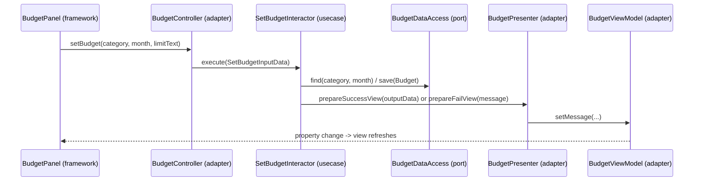

# Architecture (Clean Architecture)

## Layers and the dependency rule

Source code depends only inward: `framework -> adapter -> usecase -> entity`.
`app/` (ApplicationBuilder, MainApp) is the composition root and may see everything.

```
+--------------------------------------------------------------+
| framework  JavaFX panels, in-memory / JSON storage, CSV,     |
|            exchange-rate HTTP client                         |
|  +--------------------------------------------------------+  |
|  | adapter  Controller, Presenter, ViewModel              |  |
|  |  +--------------------------------------------------+  |  |
|  |  | usecase  Interactors, Input/Output boundaries,   |  |  |
|  |  |          data access ports (interfaces)          |  |  |
|  |  |  +--------------------------------------------+  |  |  |
|  |  |  | entity  Money, Category, Budget, ...       |  |  |  |
|  |  |  +--------------------------------------------+  |  |  |
|  |  +--------------------------------------------------+  |  |
|  +--------------------------------------------------------+  |
+--------------------------------------------------------------+
```

`ArchitectureRulesTest` fails the build if `entity`, `usecase` or `adapter` import a layer
they must not know (JavaFX, `java.io`, `java.sql`, `java.net`, an outer package).

## Packages

| Package | Contains |
|---|---|
| `entity` | `Money`, `Category`, `Budget`, `BudgetStatus` (shared entities from Person A and C go here too) |
| `usecase.<name>` | `InputBoundary`, `InputData`, `Interactor`, `OutputBoundary`, `OutputData` for each use case |
| `usecase.port` | Interfaces the use cases need: `BudgetDataAccess`, `SpendingDataAccess`, `CategoryDataAccess` (plus A's and C's ports) |
| `adapter` | `BudgetController`, `BudgetPresenter`, `BudgetViewModel` |
| `framework` | `BudgetPanel`, `InMemory*DataAccess`, `PlaceholderPane` (later: JSON storage, CSV writer, HTTP client) |
| `app` | `ApplicationBuilder` (wires everything), `MainApp` (window with tabs) |

## Use case flow: SetBudget



CheckBudgetStatus follows the same path. The Interactor also calls `SpendingDataAccess`
(Person A) for the amount spent and compares it with the limit.

## Why it is built this way

- **Dependency inversion:** Interactors depend on port interfaces, not on JSON, HTTP or JavaFX.
  Storage or the exchange-rate provider can change without touching a use case.
- **Testability:** use case tests use fakes (see `TestSupport`), so they need no files, UI or internet.
- **Single responsibility:** the Controller reads input, the Interactor applies rules, the Presenter
  formats text, the ViewModel holds state, the Panel draws it.
- **Interface segregation:** budgets only need two narrow ports (`SpendingDataAccess`,
  `CategoryDataAccess`), not a big "everything" interface.

## How a teammate adds their feature

1. Add entities to `entity/` (use the shared `Money`).
2. Add `usecase/<your_use_case>/` with the five boundary/interactor classes and any new port in `usecase/port/`.
3. Add Controller, Presenter and ViewModel to `adapter/`.
4. Add the JavaFX panel and storage/HTTP implementation to `framework/`.
5. In `ApplicationBuilder`, add a `buildXxxView()` method and replace the `PlaceholderPane` for your tab.
6. Run `mvn test`; `ArchitectureRulesTest` must still pass.
